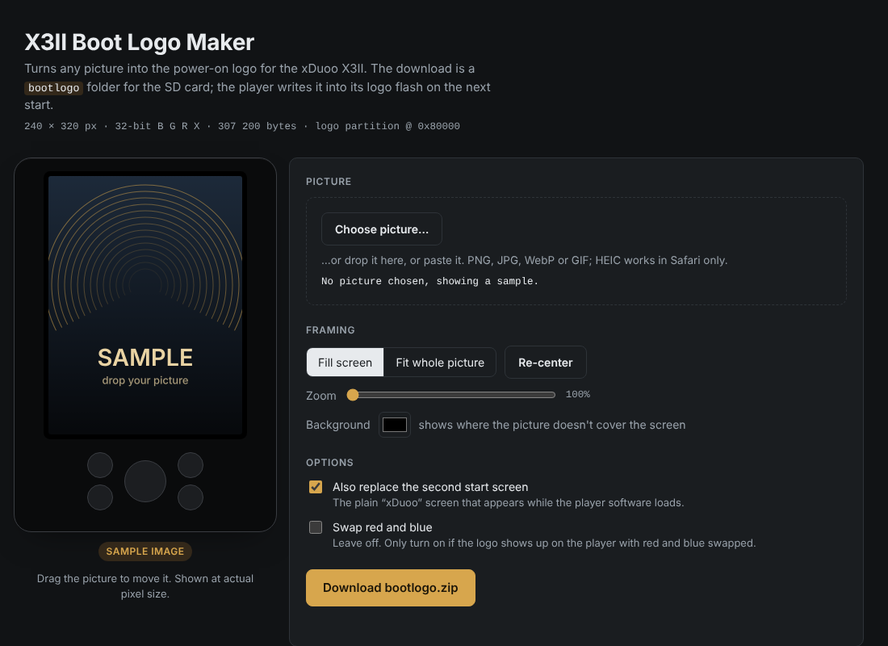

# xDuoo X3II boot logo

Replace the picture the xDuoo X3II shows when you switch it on: the gold "xDuoo · Hi-Fi Digital Audio Player" splash.

Themes can't change that picture, and neither can a firmware update. The bootloader reads it from a flash partition of its own before Linux or any theme is loaded, and `update.upt` packages never write that partition. This project adds a small start-up script to [SinuXVR's custom firmware](https://github.com/SinuXVR/xDuoo-X3II-custom-firmware). The script takes a `logo.bin` from the SD card and writes it into the logo partition. It also includes a converter that turns any picture into that `logo.bin`.

**Converter:** https://akod1ng.github.io/xduoo-x3ii-bootlogo/ (runs in the browser, nothing is uploaded)



> **Status:** tested against a simulated flash partition (see `tests/`), not yet confirmed on a real player. The colour byte order (B, G, R, X) is inferred from the bootloader and the framebuffer format. If your logo comes out with red and blue swapped, use the converter's "Swap red and blue" option and flash again. Reports welcome.

## Quick start

1. **Build the firmware with the hook** (once). Get `update.upt` from [SinuXVR's repository](https://github.com/SinuXVR/xDuoo-X3II-custom-firmware) (the bigger-font and Chinese variants work too) and run:
   ```sh
   sudo tools/build_update.sh update.upt update_bootlogo.upt
   ```
   See [Building](#building-the-firmware) for requirements, or use the Docker one-liner there.
2. **Install it.** Rename the result to `update.upt`, copy it to the root of the SD card and run *System settings → Firmware update*. Themes in `.themes` on the card are kept.
3. **Make the logo.** Open the [converter](https://akod1ng.github.io/xduoo-x3ii-bootlogo/), drop in a picture, position it, and download `bootlogo.zip`. Or use the command line:
   ```sh
   python3 tools/make_logo.py picture.jpg      # writes bootlogo/logo.bin and bootlogo/boot_animation.png
   ```
4. **Put it on the card.** Unzip so that `bootlogo/logo.bin` sits in the root of the SD card.
5. **Restart, wait, restart.** On the first start the player writes the logo, which takes a few seconds; wait about half a minute before switching off. It renames the file to `logo.bin.done` and writes a log to `bootlogo/flash_log.txt`. The next power-on shows your picture.

**Undo:** the first run saves the original to `bootlogo/original_logo.bin`. Rename it to `logo.bin` and restart.

**Second start screen:** if `bootlogo/boot_animation.png` is present, it replaces the plain "xDuoo" screen shown while the player software loads. The original is kept as `bootlogo/original_boot_animation.png`.

### Without reflashing (ADB, untested)

The player software starts `adbd` when it is connected over USB, so this may work without installing anything:

```sh
adb push firmware/bootlogo_flash.sh /tmp/
adb push bootlogo/logo.bin /tmp/
adb shell sh /tmp/bootlogo_flash.sh /tmp/logo.bin /mnt/sd_0
```

## How it works

### Flash layout

From the partition table in the kernel (`uImage`, board `ingenic-x3ii`), SPI NAND with 128 KiB erase blocks and 2 KiB pages:

| mtd | name | offset | size |
|---|---|---|---|
| mtd0 | uboot | `0x0000000` | 512 KiB |
| mtd1 | **logo** | `0x0080000` | 2.5 MiB |
| mtd2 | kernel | `0x0300000` | 6 MiB |
| mtd3 | recovery | `0x0900000` | 7 MiB |
| mtd4 | rootfs | `0x1000000` | 64 MiB |
| mtd5 | data | `0x5000000` | rest |

`update.upt` is an ISO image containing `uboot.bin`, `uimage.bin` and `system.ubi` (UBIFS), and `update.txt` lists only those three. The logo partition is never part of an update.

### The bootloader

U-Boot 2013.07 for the Ingenic X1000. With the panel in 32-bit mode it prints `draw logo` and runs

```
sfcnand read 0x80000 0x4b000 <framebuffer address>
```

That copies 0x4B000 = 307 200 bytes from the start of the logo partition straight into the framebuffer: 240 × 320 pixels × 4 bytes, no header, no compression, rows top to bottom. The converter writes each pixel as `B G R 0xFF`, which is little-endian XRGB8888.

### The second screen

After the kernel starts, the player software (`hiby_player`) shows `/usr/resource/gui/boot_animation/animation00.png`, a 240 × 320 PNG with "xDuoo" on black. It is an ordinary file in the root filesystem.

### What the hook does

`firmware/S92_01_bootlogo` runs at start-up in the background, so it adds no boot time. It waits for the SD card and, if `bootlogo/logo.bin` exists, runs `firmware/bootlogo_flash.sh`, which:

1. checks the file is exactly 307 200 bytes;
2. finds the `logo` partition in `/proc/mtd` and reads the blocks it will rewrite;
3. refuses to continue if there is a bad block in that area;
4. saves `original_logo.bin` and a full `logo_partition_backup.bin` to the card, once only;
5. erases only the 3 blocks the logo occupies and writes the new logo plus the bytes that followed the old one in those blocks, unchanged;
6. reads it back and compares, and on a mismatch writes the old content back.

Only the logo partition is written. Bootloader, kernel and root filesystem are not touched by the hook. A bad logo means a garbled splash, and the player still boots.

## Building the firmware

`tools/build_update.sh` unpacks `update.upt`, adds `usr/bin/bootlogo_flash.sh` and `etc/init.d/S92_01_bootlogo` to the root filesystem with the same owner and mode as the other init scripts, and rebuilds `system.ubi` with the original parameters (`mkfs.ubifs -x lzo -e 0x1F000 -c 1024 -m 0x800`). It then updates the rootfs md5 in `update.txt`, packs the ISO again, and checks every md5 in the result. Kernel and bootloader are copied unchanged.

Linux, as root, with `mtd-utils`, `genisoimage`, `libarchive-tools` (or `p7zip`) and `ubi_reader`:

```sh
sudo apt install mtd-utils genisoimage libarchive-tools python3-pip
sudo pip install ubi_reader            # add --break-system-packages on newer distros
sudo tools/build_update.sh update.upt update_bootlogo.upt
```

On macOS or Windows, Docker does the same:

```sh
docker run --rm -v "$PWD":/w -w /w ubuntu:24.04 bash -c \
  "apt-get update -qq && apt-get install -y -qq mtd-utils genisoimage libarchive-tools python3-pip >/dev/null \
   && pip install -q --break-system-packages ubi_reader \
   && tools/build_update.sh update.upt update_bootlogo.upt"
```

Unpacking and repacking SinuXVR's image without changes gives back an identical file tree, including owners and modes. With the hook added, the only difference is the two new files.

## Tests

```sh
tests/run_tests.sh
```

Runs `bootlogo_flash.sh` under `busybox sh` (the player's shell) against a simulated NAND partition. The simulation follows NAND rules: erase sets bytes to `0xFF` and writes can only clear bits. Cases covered: normal write, rewriting the same logo, wrong file size, restoring the backup, a bad block in the logo area, and a missing logo partition.

## Layout

```
firmware/bootlogo_flash.sh   writes logo.bin into the logo partition (runs on the player)
firmware/S92_01_bootlogo     init script that calls it from the SD card at start-up
tools/build_update.sh        adds both to an update.upt
tools/make_logo.py           picture -> logo.bin (and --show logo.bin -> png)
docs/index.html              browser converter (GitHub Pages)
tests/                       simulated-flash tests for the flasher
```

## Credits

- [SinuXVR](https://github.com/SinuXVR/xDuoo-X3II-custom-firmware) for the custom firmware this builds on. This repository doesn't redistribute it; download it from there.
- xDuoo for the X3II. Not affiliated with xDuoo.

Modifying firmware is at your own risk.

## License

MIT for the code in this repository (see `LICENSE`). The firmware itself belongs to its respective owners.
